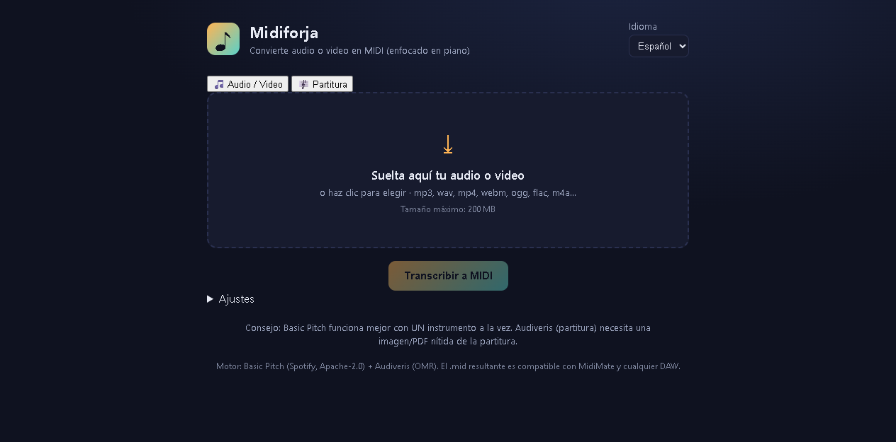
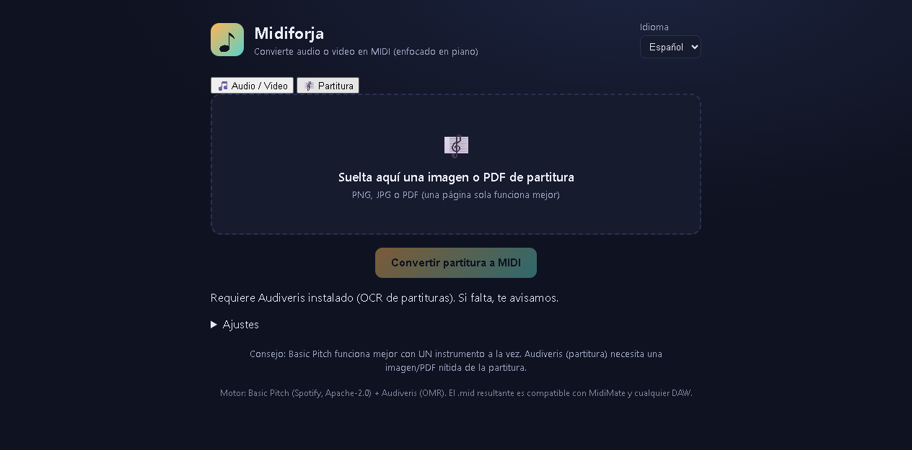

# Midiforja

> Convierte audio o video en MIDI. Enfocado primero en piano (un instrumento a la vez).
> El `.mid` resultante es compatible con [MidiMate](https://github.com/Zabat-code) y cualquier DAW.

## Stack

- **Backend** (Python 3.11): FastAPI + Spotify **Basic Pitch** (Apache-2.0) para la
  transcripción, `ffmpeg` para extraer audio de video, y un writer de Standard MIDI File
  propio (`backend/midiwriter.py`) que coloca las notas en ticks reales (segundos) para que
  suenen a la velocidad correcta.
- **Frontend** (Vite + vanilla JS): subida de archivo (drag & drop), barra de progreso,
  descarga del `.mid`, e i18n **ES/EN** con switch.

## Requisitos

- Python 3.11 (se usa un venv en `backend/.venv`).
- Node 18+ y npm (para el frontend Vite).
- `ffmpeg` en el PATH (o en `C:\Users\Winuser\AppData\Local\Microsoft\WinGet\Links\ffmpeg.exe`).
- Conexión a internet la **primera** vez que corre Basic Pitch (descarga el modelo de TF Hub).

## Puertos

- Backend API: `http://127.0.0.1:8000`
- Frontend dev: `http://127.0.0.1:5174` (puerto fresco, no colisiona con MidiMate)

## Cómo correr (dev)

1. Backend (el venv de Python 3.11 vive en la raíz del repo, en `.venv/`):
   ```bat
   cd <repo>\Midiforja
   .venv\Scripts\activate
   pip install -r backend\requirements.txt
   python backend\server.py
   ```
   O usa `run_backend.bat` (ajusta la ruta del venv si lo reubicas).

2. Frontend (en otra terminal):
   ```bat
   cd <repo>\Midiforja\frontend
   npm install
   npx vite --port 5174
   ```
   O usa `run_frontend.bat`.

3. Abre `http://127.0.0.1:5174/`, suelta un audio/video, pulsa "Transcribir a MIDI",
   y descarga el `.mid`.

## Usar el MIDI en MidiMate

El `.mid` es Standard MIDI File tipo 1, `ticksPerBeat = 480`, con un evento de tempo
(120 BPM) en la pista 0 para que la velocidad sea correcta. MidiMate lo lee con su
`src/midi.js` (`parseMidi` + `midiToNotes`). Descarga el archivo y cárgalo en MidiMate
( drag & drop / file input ). Midiforja NO está acoplado a MidiMate: el `.mid` sirve
en cualquier DAW.

## OMR — partitura → MIDI (Fase B, operativo)

Además de audio/video, Midiforja puede transcribir una **imagen o PDF de partitura**
a MIDI mediante [Audiveris](https://github.com/Audiveris/audiveris) (OMR, Apache-2.0).

- Pestaña **"Partitura"** en el frontend: suelta un `.png/.jpg/.pdf/.tiff` y descarga el `.mid`.
- Endpoint: `POST /api/transcribe-sheet`.
- Audiveris debe estar instalado. Midiforja lo auto-detecta en las rutas comunes
  (`C:\Program Files\Audiveris\Audiveris.exe`, `%LOCALAPPDATA%\Audiveris\...`). Si no se
  detecta, define la variable `MIDIFORJA_AUDIVERIS_BIN` con la ruta al launcher.
- El MusicXML (`.mxl`, que es un ZIP) lo convierte `backend/musicxml2midi.py` a Standard
  MIDI File.

## Capturas

**Pestaña Audio / Video** — suelta un audio o video y descarga el `.mid`:



**Pestaña Partitura (OMR)** — suelta una imagen/PDF de partitura y descarga el `.mid`:



## Límites conocidos (básicos)

- **Basic Pitch es instrument-agnostic y polifónico, pero funciona mejor con UN
  instrumento a la vez.** Una canción completa con muchos instrumentos produce notas
  mezcladas (no separa pistas). Para multi-instrumento haría falta source separation
  (p.ej. Demucs) antes de transcribir — fase futura opcional.
- Tamaño de archivo capado a 200 MB.
- Sin GPU, la transcripción en CPU puede tardar (segundos a minutos por minuto de audio).

## Estructura

```
Midiforja/
  backend/
    server.py        # FastAPI: /api/transcribe (ffmpeg -> basic-pitch -> .mid)
    midiwriter.py    # Standard MIDI File writer (ticks en segundos reales)
    test_writer.py   # Valida el .mid contra el parser de MidiMate
    test_e2e.py      # Piano sintético -> /api/transcribe -> .mid (E2E real)
    requirements.txt
    .venv/           # entorno Python 3.11 (no se commitea)
  frontend/
    index.html
    src/main.js      # lógica de UI
    src/i18n.js      # tablas ES/EN
    src/style.css
    vite.config.js
  run_backend.bat
  run_frontend.bat
```

## Licencia

Código de Midiforja: MIT. Motor de transcripción Basic Pitch (Spotify): Apache-2.0.
